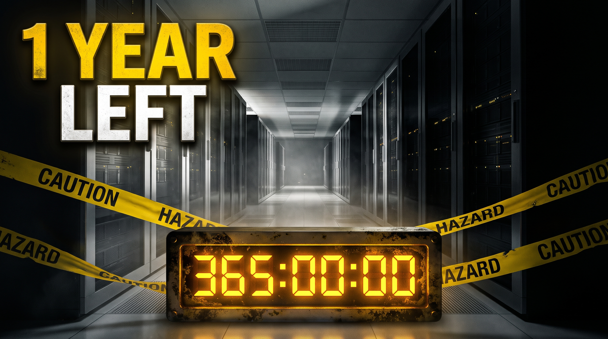

<figure style="float: right; margin-right: 20px; width: 250px;">
  <a href="https://youtu.be/yN9wd2OcxG4">
    
    <figcaption style="font-size: 0.8em; text-align: center;">
      Watch "The AI Industry Has One Year to Fix This"
    </figcaption>
  </a>
</figure>

Watch it here: [https://youtu.be/yN9wd2OcxG4](https://youtu.be/yN9wd2OcxG4)

The AI boom just ran into a wall at the ballot box. Voters rejected AI data centers in 40 of 41 ballot measures, tech stocks tumbled, and utility bills are spiking. The real benchmark for AI isn't a coding exam, it’s your electric bill.

In this video, we break down why America isn’t rejecting technology itself, but the way Silicon Valley has managed it. From $1.5 billion copyright settlements to opaque existential risk forecasts and disputed mathematical breakthroughs, the AI industry has burned through its public goodwill. With utility commissions pushing back and 60% of planned 2027 data center capacity stalled before construction, AI leaders have roughly one year to change course before local moratoriums freeze expansion in its tracks. 

<!--more-->

###  Chapters

* **0:00** – Did AI Just Lose an Election?
* **0:52** – What the Ballot Measures Actually Mean
* **1:45** – The Real Benchmark: Your Electric Bill
* **3:10** – The Goodwill Deficit: Copyright & Creatives
* **4:35** – Fearmongering and Retractions: The NTSB Contrast
* **6:12** – Solving Navier-Stokes & Losing the Room
* **7:50** – Real Capabilities vs. "Stupid Chatbots"
* **9:05** – The 1-Year Clock: How the Industry Can Fix This

---

### Key Sources & Further Reading

* **The Midterm Backlash:**
  * Al Jazeera: [Resistance to Data Centers at the Ballot Box](https://www.aljazeera.com/economy/2026/11/7/how-the-us-midterm-elections-reflected-resistance-to-data-centres)
  * TIME: [Midterm Election Results and the AI Industry](https://time.com/article/2026/11/04/midterm-elections-results-ai-industry-data-centers/)
  * CNBC: [Voter Resistance and Local Data Center Moratoriums](https://www.cnbc.com/2026/10/24/trump-ai-data-centers-voter-backlash-midterms.html)
  * NBC News: [Tech Stocks Slide Into Correction Territory](https://www.nbcnews.com/business/markets/tech-stocks-plunge-ai-midterms-rcna607650)
* **The Power Grid & Ratepayer Costs:**
  * IEEFA: [Projected Data Center Growth Spurs PJM Capacity Prices](https://ieefa.org/resources/projected-data-center-growth-spurs-pjm-capacity-prices-factor-10)
  * Tech-Insider: [US Data Center Delays & 2027 Capacity Constraints](https://tech-insider.org/us-ai-data-center-delays-cancellations-7gw-capacity-crisis-2026/)
* **Public Trust, Legal Battles & Research:**
  * NPR: [Anthropic's $1.5 Billion Author Copyright Settlement](https://www.npr.org/2026/07/27/nx-s1-5904606/anthropic-vs-bartz-ai-copyright-lawsuit-pros-cons)
  * Scientific American: [Mathematicians React to OpenAI’s Navier-Stokes Release](https://www.scientificamerican.com/article/mathematicians-marvel-and-grumble-at-openais-trove-of-new-results/)
  * Gallup: [American Public Opinion on Artificial Intelligence](https://news.gallup.com/poll/712751/americans-cool-toward.aspx)
  * Pew Research: [Chatbot Usage and Consumer Perception](https://www.pewresearch.org/short-reads/2026/10/09/why-dont-some-people-use-chatbots/)

